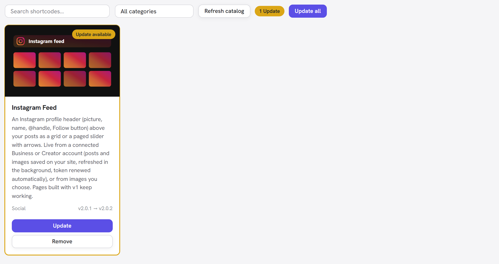

# Shortcode Library

The base plugin stays lean by shipping only the core elements. Everything else — optional
shortcodes and design packs — lives in the **Shortcode Library**, where you install just the
ones you want. Each one installs into your active theme and appears in the Page Builder; the
plugin itself never grows heavier than it needs to be.

## Where it is

In **wp-admin → Unyson+ → Shortcodes → Library** tab. You'll see a searchable grid of
available shortcodes with a thumbnail, description, category, and version for each. Use the
search box and category dropdown to narrow the list.

## Installing

Click **Install** on any card. The library downloads that shortcode's package, verifies it
against a checksum, and extracts it into your theme at
`framework-customizations/extensions/shortcodes/shortcodes/<slug>/`, where the framework
auto-registers it. After it installs, **reload the Page Builder** to use the new element.

Click **Remove** to uninstall one; its folder is deleted and it disappears from the builder.

## Updating

The library tracks **which version of each installed shortcode you have** and compares it to
the catalog, so when a newer version is published it tells you — no more removing and
reinstalling to get the latest.

When an update is available you'll see:

- An amber **Update available** badge on the card (and an amber outline).
- A version line reading **vYOUR‑VERSION → vNEW‑VERSION**, so you know exactly what changes.
- An **Update** button — one click reinstalls the newer version in place (your **Remove**
  option stays below it).
- A count in the toolbar (e.g. **2 Updates**) and an **Update all** button that updates every
  outdated shortcode in one go.

Updating never touches pages you've already built — it only replaces the element's code with
the newer version. Reload the Page Builder afterwards to pick it up.

### How it knows

On install or update, the library writes the installed version into a hidden `.upw-version`
file inside the shortcode's folder, then compares that against the catalog on each visit.
Shortcodes that were installed before update detection existed (or while the catalog was
offline) **adopt the current catalog version as their baseline** the first time the online
catalog is reached — so only a *future* release flags them, and you never get a one-off
"everything needs updating" burst.

## When the catalog can't be reached

The library caches the online catalog and falls back to a small built-in list if the catalog
server is briefly unreachable, showing a notice that it's using the built-in list. Use
**Refresh catalog** in the toolbar to re-check immediately.
